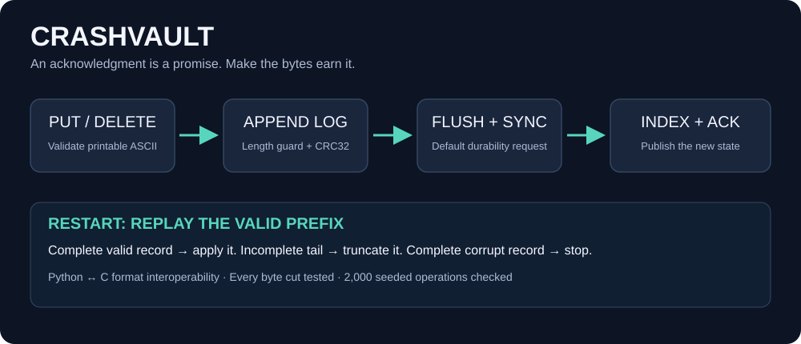

<div align="center">

# CrashVault

### An acknowledgment is a promise. Make the bytes earn it.

**A small log-structured storage engine, independently implemented in Python and C11.**

[](https://github.com/mohammmad357/crashvault/actions/workflows/ci.yml)


[](LICENSE)



[Quick start](#quick-start) · [File format](FORMAT.md) · [Measured results](results/RESULTS.md) · [Resume notes](RESUME.md) · [فارسی](README.fa.md)

</div>

## The engineering problem

Your process says a write succeeded. Then it dies. Which records should exist after restart?

CrashVault stores every mutation in an append-only binary log. It reconstructs an in-memory key/value index on startup. Both languages use the **same versioned format**, produce byte-for-byte identical logs for identical mutations, and read logs written by each other.

The interesting boundary is between an **incomplete final record** and a **complete corrupt record**. A truncated tail can be discarded; a corrupt complete record must stop recovery instead of silently losing accepted data. A guarded length field prevents a single-bit length corruption from masquerading as a longer unfinished record. CRC32 detects accidental payload corruption.

## Quick start

Requires Python 3.11+ and, for native builds, GCC or a compatible C11 compiler. There are no third-party runtime dependencies.

```bash
git clone https://github.com/mohammmad357/crashvault.git
cd crashvault
printf 'PUT\tuser:42\tAda\nGET\tuser:42\nSTATS\n' | python python/crashvault.py demo.log
```

Build and use C on Linux/macOS:

```bash
mkdir -p build
gcc -std=c11 -D_POSIX_C_SOURCE=200809L -O2 -Wall -Wextra -Wpedantic c/crashvault.c -o build/crashvault
printf 'GET\tuser:42\nDEL\tuser:42\n' | ./build/crashvault demo.log
python -m unittest discover -s tests -v
```

Windows PowerShell:

```powershell
New-Item -ItemType Directory -Force build | Out-Null
gcc -std=c11 -O2 -Wall -Wextra -Wpedantic c/crashvault.c -o build/crashvault.exe
"PUT`tuser:42`tAda", "GET`tuser:42", "STATS" | python python/crashvault.py demo.log
"GET`tuser:42", "DEL`tuser:42" | ./build/crashvault.exe demo.log
python -m unittest discover -s tests -v
```

The CLI takes tab-separated commands and emits one JSON response per successful command. Input errors and corrupt logs produce exit status 2. Open a file with **one process/Store at a time**, including readers: startup may repair its tail and no process locking is implemented.

| Command | Response | Effect |
|---|---|---|
| `PUT<tab>key<tab>value` | `{"ok":true}` | Append a value, overwriting any old value |
| `GET<tab>key` | `{"value":"Ada"}` or `{"value":null}` | Read current in-memory state |
| `DEL<tab>key` | `{"deleted":true}` or `false` | Append a tombstone, even if the key is absent |
| `STATS` | Key/record counts and byte counts | Observe the reconstructed state |

Keys are 1..1024 printable ASCII bytes. Values are 0..65,536 printable ASCII bytes; an empty string is distinct from a missing key. Tabs/newlines are protocol separators and unsupported within fields. Files are capped at 2 GiB for parity with the C implementation's offset limit. C paths on Windows use the runtime's narrow-character filename interface; use paths representable in the active code page.

Python also exposes a small API:

```python
import sys
sys.path.insert(0, "python")
from crashvault import Store

with Store("app.log") as store:
    store.put("status", "ready")
    assert store.get("status") == "ready"
    store.delete("status")
```

## Write ordering and durability scope

For each mutation: **validate → append frame → flush library buffers → request file sync → update index → acknowledge**. Python uses `os.fsync`; C uses `fsync` on POSIX and `_commit` on Windows. A failed append or sync produces no success acknowledgment; the Python handle rejects further mutations until reopened. A command without a received acknowledgment may still have reached the log, so acknowledgment loss does not prove absence.

This establishes an explicit file-sync boundary for an existing log. The project does **not sync the parent directory when creating a file**, so newly-created filenames have no separately established power-loss durability guarantee. Filesystem and device behavior still determine physical persistence. The test suite validates process death and simulated byte truncation; it does not simulate a power cut or arbitrary device write reordering. The storage calls are documented in [Python's os.fsync reference](https://docs.python.org/3/library/os.html#os.fsync) and [Microsoft's _commit reference](https://learn.microsoft.com/en-us/cpp/c-runtime-library/reference/commit?view=msvc-170).

`--no-sync` / `Store(..., sync=False)` skips the sync request. This mode exists for controlled experiments and changes the acknowledgment guarantee. Reports keep synced and unsynced timings separate.

## Recovery contract

| File state | Result |
|---|---|
| Empty file, or a matching partial magic header | Initialize a valid header |
| Complete valid frames | Replay mutations in order; the latest value wins |
| Incomplete final header/payload/checksum | Truncate to the last complete valid frame |
| Complete invalid length guard, checksum or fields | Raise an error and leave bytes unchanged |
| Wrong file magic/version | Raise an error and leave bytes unchanged |

The model tested is **prefix truncation of a valid log**. CRC32 and redundant lengths detect accidental damage; they are not authentication and do not defend against someone deliberately rewriting checksums. Opening a new file creates a log even for a read-only CLI command.

## Evidence, not just a happy path

- **2,000 seeded operations** checked against a dictionary reference, with matching JSON responses and identical log bytes across languages.
- **All 116 byte-cut positions** of a multi-record overwrite/delete history checked for exact recovered state, repaired bytes and successful continuation.
- **All 232 single-bit flips** in a complete small log rejected in both implementations, without rewriting the damaged file.
- Actual process termination **after a synced acknowledgment**, followed by successful reopen.
- Maximum field sizes, empty values, malformed records with valid CRC, hash collisions and deleted-slot probing.
- An injected Python sync-stage failure checks that the in-memory value is not published and further writes on the handle are rejected. C storage-call fault injection is not implemented.

CI compiles C with warnings treated as errors, runs on Python 3.11/3.13 and repeats tests under address and undefined-behavior sanitizers on Linux. The badge records remote CI status; local success alone is not a remote result.

## Architecture and complexity

Python uses a dictionary. C implements an FNV-1a hash table with linear probing, tombstones, resizing and same-capacity rehashing to clear excessive tombstones. Lookup/index updates are expected O(1), with O(K) worst-case collision chains for K stored keys. FNV-1a is not collision-resistant.

Record construction/checksum costs O(key bytes + value bytes). Replay costs O(log bytes) plus expected hash operations. Memory stores the live keys and values plus one bounded frame buffer in C; Python's replay also reads one bounded frame at a time. The log retains overwrite history and delete records. There is **no compaction**, so disk space and replay work grow with historical mutations rather than current live-key count. Memory allocation or storage failure may leave an unacknowledged complete record; recovery remains the authority.

## Reproduce the benchmark

```bash
python tools/benchmark.py --binary build/crashvault --count 10000 --sync-count 200 --samples 5
```

Use `build/crashvault.exe` on Windows. The script checks output counts and writes [raw samples](results/raw.csv), [environment details](results/environment.json) and the [measured report](results/RESULTS.md). Timings cover entire CLI processes, including startup, protocol handling and output. They are not isolated language-speed measurements. The synced workload has fewer operations, so fixed startup costs affect it more.

## Repository map

```text
python/crashvault.py   Storage API and tab-separated CLI
c/crashvault.c        Matching C11 engine and custom hash index
tests/                Recovery, corruption and interoperability evidence
tools/benchmark.py    Reproducible end-to-end measurements
FORMAT.md             Binary format and recovery rules
RESUME.md             Evidence-based portfolio/resume wording
assets/               Architecture visual
results/              Raw data, environment and report
```

## Next engineering steps

Compaction with atomic replacement and directory sync; exclusive process locking; binary/UTF-8 fields; injectable short-write/sync failures for the C runtime; and a stronger power-loss model. Each would need its own tests and format/compatibility decisions. Multi-key transactions, snapshots, replication and network access are outside this version's scope.

MIT licensed. Original code and architecture asset; no external implementation or artwork is bundled.
